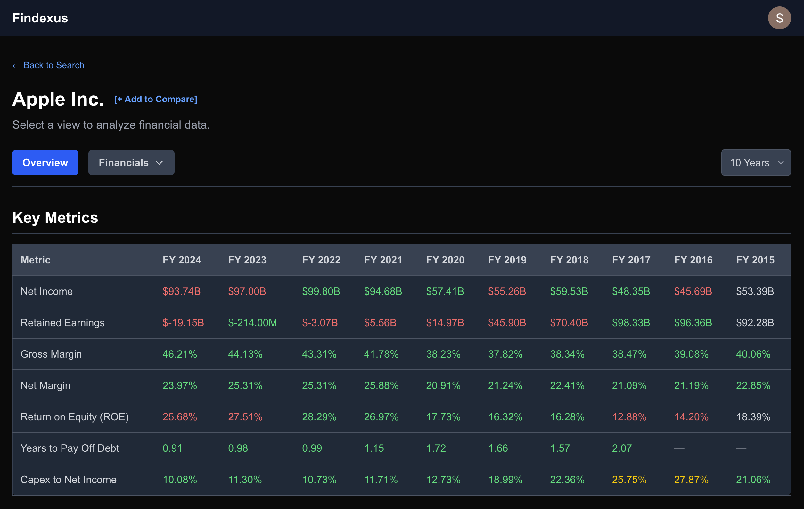

# Findexus

A full-stack web application designed to speed-up investment research by allowing you to access SEC Filings from simply entering a ticker symbol in a search bar.

 ---

## About The Project

For many investors, the research/learning process is fragmented. Juggling multiple browser tabs for stock quotes, financial statements, and more is inefficient and makes it difficult to build a cohesive investment thesis.

**Findexus** solves this by fetching comprehensive company information across multiple years with a simple ticker search. It allows users to focus on what matters most: analysis and strategy.

---

## Key Features

* **Comprehensive Financial Analysis:** Instantly access over 20 years of financial data from SEC filings (10-K) for any publicly traded company.

* **Automated Ratio Calculation:** Go beyond raw numbers with automatically calculated key metrics, including:
    * **Profitability Ratios:** Gross Margin & Net Margin with color-coded indicators for common financial health benchmarks (e.g., >40% Gross Margin).
    * **Shareholder Value:** Return On Equity (ROE) to measure how effectively profits are generated from shareholder investments.
    * **Financial Stability:** Years to Pay off Debt and Capex to Net Income ratios to quickly assess a company's debt load and reinvestment strategy.

* **Side-by-Side Company Comparison:** Directly compare the key metrics of multiple companies to quickly identify industry leaders and benchmark performance.

* **Intelligent Caching:** A multi-layered caching system (client-side with TanStack Query, server-side with Supabase) ensures snappy performance and rapid data retrieval for frequently accessed companies.

---

## Built With

* **Frontend:** [Next.js](https://nextjs.org/) (React) & [Tailwind CSS](https://tailwindcss.com/)
* **Backend:** [FastAPI](https://fastapi.tiangolo.com/) (Python)
* **Database & Auth:** [Supabase](https://supabase.io/) (PostgreSQL & Google OAuth)
* **Deployment:** Vercel (Frontend) & Render (Backend)
* **Data Source:** [EdgarTools](https://edgartools.readthedocs.io/en/latest/) for SEC Filings